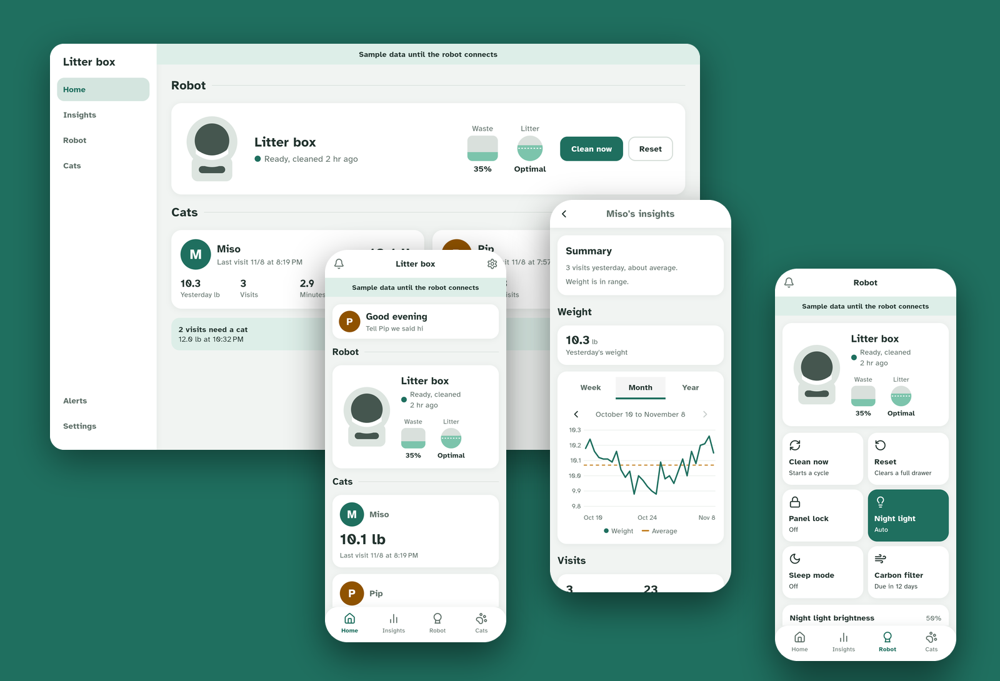

# Litterbox Local

Keep your litter-robot 4 data on your own machine, with no 30 day limit and nothing behind a paywall.



It runs in docker at home and takes the place of the whisker cloud.
Built on [whiskerless](https://github.com/SisyphusMD/whiskerless), not affiliated with whisker.

## What you get

- Every visit and clean cycle, kept for as long as you run it
- Weight and visit history for each cat
- Robot controls, upkeep reminders and alerts
- Your last month of whisker history, if you import the export

## Install

You need docker on something that stays on, on the same network as the robot.
Ports 8883 and 8420 have to be free on it.

```bash
./install.sh
```

It asks for the machine's LAN address, which has to stay fixed, and the serial on the robot's label.
It prints the dashboard address and access key, and doesn't touch the robot.

## Connect the robot

Run this near the robot, on a computer with bluetooth, python3 and internet.

```bash
scripts/connect-robot.sh
```

On a computer that isn't the server, copy `data/certs/ca.crt` over first.

```bash
scripts/connect-robot.sh --host 192.168.1.50 --ca ./ca.crt --serial LR4C123456 --key YOUR_ACCESS_KEY
```

It wipes the robot's wifi partway through, so only start it if you have a few minutes.
The whisker app stops working for this robot once it's connected here.
If it fails, run it again or use the whisker app's setup flow.
After reinstalling the server, run it with `--forget-old-server`.

## Apps

- Web: open the dashboard address and log in with the access key.
- Android: download the apk from the [releases page](https://github.com/NC1107/whisker-local/releases) and allow installing from unknown sources.
  The app asks for the server address, like `192.168.1.50:8420`, and the access key.
- iOS: testflight, see below, or use the web app.

### iOS testing

It's not on the app store yet.
To test it in testflight, [open an issue](https://github.com/NC1107/whisker-local/issues/new) asking to be added, without your email, and I'll ask for your apple id privately.

## Notifications

Off by default, and nothing is sent anywhere until you turn them on.
iOS only for now, through my relay, so alert text and your phone's push token pass through it.
Details are in [docs/DEPLOYMENT.md](docs/DEPLOYMENT.md#push-notifications).

## Going back

Run the whisker app's setup flow for the robot, it should put the cloud settings back.
That round trip hasn't been tested on this setup yet, the details are in [docs/going-back.md](docs/going-back.md).
`./uninstall.sh` removes the containers and images and keeps `data/`.
`--purge` also deletes your history, the certificates and the bluetooth tools, and a connected robot would need connecting again.

## Good to know

- The robot only sends a weight, so cats close in weight may need picking by hand.
- Firmware updates only come from the whisker cloud, so go back, update, then connect again.
- Backups and restoring are in [docs/DEPLOYMENT.md](docs/DEPLOYMENT.md#backups), `data/` holds private keys.

## More

- [docs/DEPLOYMENT.md](docs/DEPLOYMENT.md): settings, backups, reverse proxy, notifications
- [docs/DEVELOPMENT.md](docs/DEVELOPMENT.md): tests, and trying it with sample data and no robot
- [docs/RELEASING.md](docs/RELEASING.md): releases and signing, for the maintainer
- [docs/api.md](docs/api.md): the server API
